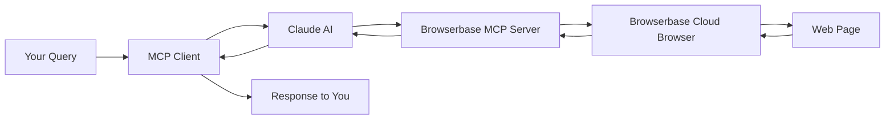

# Quick Start: Browserbase MCP Server

## 🚀 5-Minute Setup

### 1. Get Your API Keys

**Browserbase API Key:**
1. Visit https://www.browserbase.com/
2. Sign up or log in
3. Go to Settings → API Keys
4. Copy your API Key and Project ID

**Anthropic API Key:**
1. Visit https://console.anthropic.com/
2. Sign up or log in
3. Go to API Keys
4. Create and copy your API key

### 2. Configure Environment

Create a `.env` file in your project root:

```bash
ANTHROPIC_API_KEY=sk-ant-xxxxx
BROWSERBASE_API_KEY=bb_xxxxx
BROWSERBASE_PROJECT_ID=your_project_id
```

### 3. Run the Client

```bash
npm run mcp-browserbase
```

## ✨ Example Commands to Try

Once the client starts and shows `Query:`, try these:

### Basic Navigation
```
Take a screenshot of https://github.com
```

### Data Extraction
```
Go to https://news.ycombinator.com and tell me the top 3 story titles
```

### Web Scraping
```
Visit https://github.com/trending and extract information about the top repository
```

### Complex Interactions
```
Navigate to https://www.google.com, search for "Model Context Protocol", and tell me the first 3 result titles
```

## 🎯 What You Can Do

- **Browse websites** with AI assistance
- **Extract data** from web pages intelligently
- **Take screenshots** for documentation
- **Automate web interactions** with natural language
- **Scrape content** while respecting robots.txt

## 🛠️ Available Commands

- Type your query in natural language
- Type `quit` to exit
- The AI will automatically call browser tools as needed

## 📊 How It Works



## 🔍 Troubleshooting

**No output or connection error?**
- Check your `.env` file has the correct API keys
- Verify your internet connection
- Ensure you've run `npm run build` first

**Rate limit errors?**
- Check your Browserbase plan limits
- Wait a moment and try again

**Command not working?**
- Make sure you're using natural language descriptions
- Be specific about what you want to extract or do

## 📚 More Information

See `BROWSERBASE-SETUP.md` for detailed documentation.


